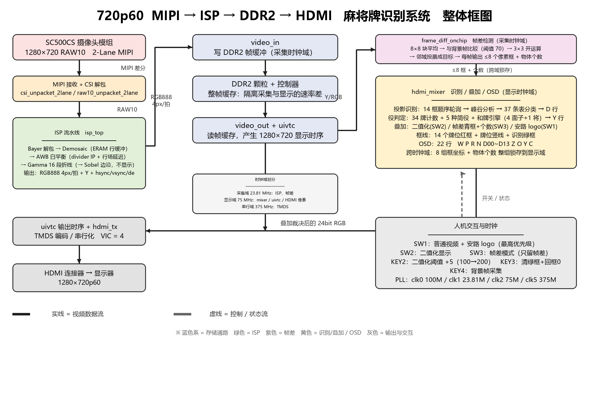

# 第二部分　系统组成及功能说明

## 2.1　整体介绍

### 2.1.1　系统概述

本系统是一套完整的 **720p60 实时图像采集—处理—显示** 平台，并在同一条显示链路上集成了三类叠加功能：

| 类别 | 功能 | 说明 |
|---|---|---|
| 基础通路 | MIPI 采集 → ISP 处理 → DDR2 帧缓存 → HDMI 输出 | 1280×720@60，VIC = 4 |
| 识别通路 | 14 个牌位的投影式牌面识别 + 役判定 | 顺序轮询，结果送 OSD |
| 辅助叠加 | 帧差运动检测、二值化显示、厂商 logo | 由拨码开关切换 |

系统由 **SC500CS 摄像头模组**、**FPGA（PH1P35MDG324）**、**DDR2 颗粒**、**HDMI 接口** 与 **人机交互开关** 五部分组成。FPGA 内部按功能划分为 **采集域**、**ISP 处理域**、**识别/检测域**、**显示域** 与 **输出域**。

---

### 2.1.2　系统整体框图

图中实线为 **视频数据流**，虚线为 **控制/状态流**；颜色区分时钟域。

---

### 2.1.3　各模块说明及相互关系

#### （1）采集域——传感器与 MIPI 接收

| 模块 | 功能 | 输入 / 输出 |
|---|---|---|
| SC500CS 模组 | 1280×720 RAW10 输出，2 Lane MIPI | 光 → MIPI 差分 |
| `csi_unpacket_2lane` | 拆 CSI-2 包，还原像素流 | MIPI → RAW10 + tvalid/tuser/tlast |
| `raw10_unpacket_2lane` | RAW10 解包 | 组合成每拍 4 像素 |

采集域工作在 **23.81 MHz**（clk1）与 MIPI 恢复时钟下，完成从差分信号到并行像素流的转换，是整条链路的**唯一数据源**。

#### （2）ISP 处理域——`isp_top`

| 子模块 | 功能 |
|---|---|
| `mipi_to_raw_converter` | 把 RAW10 还原为 Bayer |
| `demosaic`（含两组行缓冲 ERAM）| Bayer → RGB888 |
| **`awb`** | 自动白平衡（逐帧统计 R/G/B 均值求增益），内部含 **`divider`**（IP）与 **`signal_delay`**（用于对齐 hsync/vsync/de 与流水线延迟）|
| `axis_gamma_rgb96` | 16 段折线 Gamma，近似 y = 255·(x/255)^0.7 |
| `sobel_edge_128` | 3×3 边沿检测（保留但**不参与显示**）|
| `data128_96` / `data96_128` | 位宽转换（纯组合）|

ISP 域输出 **RGB888（每拍 4 像素）+ Y 分量 + 行场同步**，是下游两条支路的共同输入：

- **支路 A（显示主通路）**：RGB888 → DDR2 → HDMI
- **支路 B（识别/检测）**：逐像素亮度 → 投影识别 / 帧差检测

#### （3）存储与显示主通路

| 模块 | 功能 | 关系 |
|---|---|---|
| `video_in` | 把像素流写入 DDR2 帧缓冲 | 输入来自 ISP；写时钟 = 采集域 |
| DDR2 控制器（`ph1p35_324_ddr_wrapper`）| 整帧缓存，隔离采集与显示的速率差 | 采集与显示**异步**，靠整帧缓冲解耦 |
| `video_out` | 从 DDR2 连续读出 | 输出时钟 = 显示域 |
| `uivtc` | 生成 1280×720 的 hsync/vsync/de | 标准时序源 |
| `hdmi_tx` | TMDS 编码与串行化（VIC = 4）| 驱动 HDMI 输出 |

**关键关系**：DDR2 整帧缓存的存在，使得 ISP 流水线的延迟、帧率的微小差异**不会**影响显示对齐——这也是后续可以安全增删 AWB 等前端模块的前提。

#### （4）识别/检测域

**① `hdmi_mixer`（核心，全部识别逻辑集中于此）**

| 功能块 | 说明 |
|---|---|
| 二值化 | Y = (R+2G+B)/4，`Y < BIN_THR(150)` 记为"墨" |
| 红色检测 | Cr 偏移 = 4096 + 8R − 6.75G − 1.25B，`> 4600` 记为红（零乘法）|
| 投影引擎 | 14 个框**顺序轮询**，每框只做一份列/行投影（时间复用，省资源）|
| 峰谷分析 | 由投影求包围盒（W/H）、峰数（P）、列差/行差（Z）、真实列差（O）|
| 锁定 | 连续 6 帧结果一致才写入该框槽位 |
| 分类器 | 37 条参考表 × 6 道判据（红+P 硬条件、宽±4、高±3、真实列差±3、O 上下限、列差/行差±4）|
| 役判定 | 34 个牌计数 + 5 种简役 + 和牌引擎（4 面子 + 1 将）→ `Y` 行 |
| 状态机 | 4 态：`S_SCAN`（扫描）/ `S_EVAL`（评估役）/ `S_EMPTY` / `S_RESET`（清 D 与绿框）|
| OSD | 22 行文字：`W P R N D00~D13 Z O Y C`，上半屏 14 行、红框下方 8 行 |

**② `frame_diff_onchip`（帧差运动检测）**

| 环节 | 说明 |
|---|---|
| 分块 | 8×8 像素为一块，160×90 = 14400 块 |
| 块平均 | 8 行累加后 ÷64，得到 8 位块均值 |
| 背景帧 | `s_bg_ram`（14400×8 bit ≈ 6 块 ERAM），KEY4 采集/冻结 |
| 判定 | \|当前块均值 − 背景块均值\| > `DIFF_THR(70)` → 运动块 |
| 去噪 | 3×3 开运算（腐蚀+膨胀）删除孤立噪点 |
| 目标 | 每帧清空目标表，运动块按 ±4 块邻域投票，归并成至多 32 个目标 |
| 输出 | 帧末挑选命中≥2 块、尺寸≥3 块的目标，输出至多 **8 个像素坐标框** + 物体个数 |

**③ 跨时钟域处理**

帧差工作在**摄像头域**，`hdmi_mixer` 工作在**显示域**。因此 `hdmi_mixer` 内部以"帧计数变化"为标志，把 8 组框坐标与物体个数**整组锁存**到显示域，避免多位信号跨域撕裂导致的"巨大框/错位框"。

#### （5）输出域与交互

| 开关 | 功能 | 优先级 |
|---|---|---|
| **SW1** | 普通视频 + 安路 logo 叠加 | 最高 |
| **SW2** | 二值化显示 | 次 |
| **SW3** | 帧差模式：运行帧差、只显示青框与物体个数，关闭识别 OSD/红框/绿框 | — |
| SW4 | 保留（当前未使用）| — |
| **KEY2** | 二值化阈值 +5（100→200 循环）| — |
| **KEY3** | 清绿框 + 回框 0 | — |
| **KEY4** | 背景帧采集 | — |

时钟由 `PLL` 提供：**clk0 100 MHz**（DDR2/I2C）、**clk1 23.81 MHz**（采集/ISP）、**clk2 75 MHz**（像素）、**clk5 375 MHz**（TMDS）。

---

### 2.1.4　模块之间的三条关键关系

1. **单数据源、双支路**
   所有下游功能都以 ISP 输出为唯一数据源：一条支路走 DDR2→HDMI 形成显示画面，另一条支路在主时钟域做投影识别与帧差检测。两条支路**互不阻塞**（识别按帧末处理，帧差按块处理）。

2. **时间复用取代并行复制**
   牌识别对 14 个框**顺序**扫描，投影/匹配/峰谷判定各只有一份硬件资源；这是把资源从"14 份并行"压缩到"1 份时分"的关键，也是 90% slice 压力下仍能容纳识别+帧差的原因。

3. **显示域统一裁决**
   无论是识别 OSD、红/绿框、帧差青框、二值化还是 logo，最终都在 `hdmi_mixer` 的一条**显示优先级链**里裁决输出：`SW1 > 帧差模式(SW3) > 二值化(SW2) > 各叠加层 > OSD > 原始视频`。因此新增叠加功能只需在链中插入一级，不影响前面各模块。

---

### 2.1.5　资源占用（最近一次布局布线）

| 资源 | 用量 | 占比 |
|---|---|---|
| LUT6 | 8801 | 41.5% |
| 寄存器 | 17280 | 40.7% |
| ERAM20K | 59 | 54.6% |
| DSP | 32 | 80% |
| Setup WNS | 正（无违规）| — |

其中帧差背景帧占 5~6 块 ERAM，安路 logo（40×40、RGB565）与 OSD 字模以分布式 RAM 形式占用少量 LUT。
